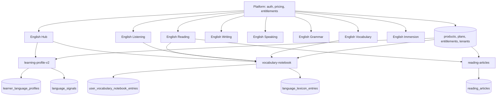

# Non-Exam English Services

This document describes the English-learning services in this repo that are not exam simulators.

Target-state companion:
- See [ENGLISH_ECOSYSTEM_BLUEPRINT.md](C:\Users\MuhammadJa'far\AntiGravityProjects\English_T1\English_T1\ENGLISH_ECOSYSTEM_BLUEPRINT.md:1) for the engineering blueprint and phased build roadmap.
- This file stays focused on current repo structure and current implementation direction.

Excluded on purpose:
- `ielts-simulator`
- `ielts-practice`
- `ielts-playbook`
- `toefl-ibt-simulator`
- `sat-simulator`
- `itep-simulator`

Included:
- `english-hub`
- `english-reading`
- `english-listening`
- `english-writing`
- `english-speaking`
- `english-grammar`
- `english-vocabulary`
- `english-immersion`

Note on current repo state:
- These services are clearly intended to be general English products.
- Some UI copy still uses phrases like "exam-focused" because parts of the broader platform were adapted from exam products.
- The architecture below describes the intended English-service direction based on the current implementation.

## 1. Portfolio Idea

The non-exam English side of the platform is designed as a connected ecosystem rather than one single course.

Core product idea:
- Split English into skill-specific services so each skill can have its own workflow.
- Keep progress, vocabulary, and personalization shared across all English products.
- Use one central hub to decide what the learner should do next.
- Treat English as a language scope, not just a single app.

In simple terms:
- `english-hub` is the orchestrator.
- `english-reading`, `english-listening`, `english-writing`, `english-speaking`, `english-grammar`, and `english-immersion` are skill/workflow products.
- `english-vocabulary` is the shared memory system for the whole ecosystem.

## 2. Service Map

| Service | Main Idea | Product Role | Current Depth |
|---|---|---|---|
| `english-hub` | Central English dashboard and daily planner | Orchestration layer | Strong |
| `english-reading` | CEFR-based reading practice with article library and vocab capture | Input/comprehension layer | Strongest learner module |
| `english-listening` | Sentence listening, dictation, replay, missed-word recovery | Listening skill layer | Medium UI, lighter backend |
| `english-writing` | Writing tasks, active correction, rewrite practice | Output/structure layer | Medium UI, lighter backend |
| `english-speaking` | Guided prompts, speaking feedback, conversation mode, shadowing | Oral production layer | Medium UI, lighter backend |
| `english-grammar` | Targeted grammar drills and error correction loops | Accuracy layer | Medium UI, lighter backend |
| `english-vocabulary` | Personal notebook plus spaced repetition | Shared memory layer | Strong |
| `english-immersion` | Real-world scenario missions combining skills | Transfer/application layer | Medium UI, lighter backend |

## 3. Shared Product Structure

Across the repo, the English services follow the same product structure:

1. Each learner-facing skill app is its own Vite/React workspace under `apps/`.
2. Each service is mapped to a real platform product in the database.
3. Each product is language-scoped to English through `product_languages`.
4. Each service uses the same auth and entitlement model from the platform layer.
5. Each service can hand the learner off to another service using deep links and intent query params.
6. Shared English progress is aggregated into one language-level profile.

Commercial and catalog structure:
- The English modules are seeded in `products` as separate active products.
- `english-reading` has a starter and monthly structure.
- The other English services currently use a monthly-access structure.
- These products are intended to be discoverable, purchasable, and entitlement-controlled like the exam products, but for general English learning.

## 4. Shared System Architecture

### 4.1 High-Level Architecture

### 4.2 Frontend Layer

Common frontend architecture:
- React 19 + TypeScript + Vite workspaces.
- One app per service under `apps/english-*`.
- Each app has its own `App.tsx`, `main.tsx`, and small `lib/` client wrappers.
- Each app uses environment-bound product IDs like `VITE_READING_PRODUCT_ID`, `VITE_WRITING_PRODUCT_ID`, and so on.
- Each app builds deep links to sibling English services for cross-service handoffs.

Common UX structure inside most English apps:
- `/` landing or overview page
- `/dashboard` protected learner workspace
- `/exercises` focused practice lane

Special cases:
- `english-reading` also has article-specific routes and admin article management.
- `english-vocabulary` also has a dedicated `/notebook` route.
- `english-hub` acts more like a central planner than a single-skill workspace.

### 4.3 Platform Layer

The English services do not run as isolated products. They sit on top of the shared platform.

Platform responsibilities:
- Supabase authentication
- user identity
- tenant membership
- entitlements
- product catalog
- plan metadata
- admin access

The `me` edge function is a core bridge:
- validates the bearer token
- loads the user
- resolves active tenant membership
- returns active entitlements
- exposes admin context when relevant

This means the English services inherit the same account and billing model as the larger platform.

### 4.4 Data Layer

The data layer is Supabase Postgres with RLS and edge functions on top.

Important shared entities:
- `products`
- `plans`
- `languages`
- `product_languages`
- `entitlements`
- `tenant_memberships`

English-specific design choice:
- English is modeled as a language scope, not just as text in one app.
- Products are linked to the `en` language in `product_languages`.
- This makes the model multi-language ready even though the current rollout is English-first.

### 4.5 Personalization Layer

The most important architectural idea is the language-scoped profile layer.

Key tables and concepts:
- `language_signals`
  - normalized learning signals tied to user, language, product, skill, and metric
- `learner_language_profiles`
  - one shared learner profile per language
- `service_breakdown`
  - per-service view of that shared language profile

What this enables:
- one English profile across all English services
- weakness detection by skill area
- daily plans in `english-hub`
- cross-service remediation

Example:
- weak vocabulary or grammar detected in one place can influence what the hub recommends next.

### 4.6 Shared Memory Layer

The vocabulary notebook is the strongest cross-service backbone in the non-exam English stack.

Core tables:
- `language_lexicon_entries`
  - canonical word record per language
- `user_vocabulary_notebook_entries`
  - learner-specific notebook state

Core function:
- `vocabulary-notebook`

Key behaviors:
- add words from any English service
- deduplicate by normalized word within English scope
- store source attribution
- schedule spaced review using Leitner boxes
- return due cards and recent cards
- update card state after review

Current Leitner rhythm:
- Box 1 -> 1 day
- Box 2 -> 2 days
- Box 3 -> 4 days
- Box 4 -> 8 days
- Box 5 -> 16 days

Strategic value:
- `english-vocabulary` is not just another module
- it is the shared memory engine for the whole English ecosystem

### 4.7 Content Layer

The strongest dedicated non-exam content backend currently belongs to Reading.

Reading content architecture:
- `reading_articles` table
- `reading-articles` edge function
- CEFR levels `A1` through `C2`
- taxonomy by category and theme
- admin CRUD for draft, published, archived states

This is a strong pattern because it shows how other English services can evolve:
- listening can later get audio libraries and transcript tables
- speaking can later get prompt banks and transcript evaluation
- grammar can later get pattern libraries and remediation trees
- immersion can later get mission/scenario catalogs

## 5. Service-by-Service Description

## 5.1 English Hub

### Idea

`english-hub` is the control tower for the whole English-learning experience.

Its job is not to teach one skill directly. Its job is to:
- show the learner where they are
- show what they should do next
- connect work across all English services

### Product Structure

Current hub structure includes:
- service overview cards
- shared progress signals
- weakness buckets like grammar, vocabulary, and fluency
- daily task generation
- notebook due-count integration
- direct links into the skill services

### Architecture

Main integrations:
- `learning-profile-v2` for the shared English profile
- `vocabulary-notebook` for due/recent vocabulary cards
- sibling service links with query params like `intent`, `skill`, and `reason`

Architectural role:
- orchestration
- personalization
- cross-service routing

### Current State

`english-hub` already behaves like a real aggregator and is one of the most structurally important English apps in the repo.

## 5.2 English Reading

### Idea

`english-reading` is the most concrete general-English learning module in the repo.

Its learning idea is:
- graded reading input
- passage understanding
- structure awareness
- vocabulary capture from real text

### Product Structure

Current structure:
- landing page
- dashboard
- exercises
- article library
- article detail view
- admin article management

Learning structure:
- interactive text mode
- sentence breakdown
- cloze-style comprehension
- intensive/extensive style reading flow

### Architecture

Frontend:
- React app with reading-specific routes
- client wrapper for article APIs
- notebook capture integration

Backend:
- `reading_articles` table
- `reading-articles` edge function
- CEFR filters
- publish/archive workflow
- admin-only mutation path

Cross-service role:
- feeds useful words into `english-vocabulary`
- can hand off structure gaps to grammar and writing

### Current State

This is the most mature non-exam learner module in the repo and the clearest template for how the other English modules should evolve.

## 5.3 English Listening

### Idea

`english-listening` is designed around short, repeatable listening loops instead of long exam sections.

Its core learning idea is:
- hear a short unit
- replay it
- slow it down
- reconstruct it
- save missed language into memory

### Product Structure

Planned/visible structure in the app:
- sentence-based listening
- dictation mode
- slow mode and looping
- missed-word feedback

### Architecture

Current architecture:
- standalone React learner app
- shared auth and entitlement checks
- vocabulary capture into the shared notebook
- service handoffs to speaking, immersion, and vocabulary

What is still light:
- there is no listening-specific content service in the repo yet comparable to `reading-articles`
- there is no dedicated non-exam listening audio/transcript backend yet

### Current State

Good product definition and UI structure are present, but the backend is still lighter than Reading or Vocabulary.

## 5.4 English Writing

### Idea

`english-writing` is meant to train usable written English through correction loops, not just passive scoring.

Its core learning idea is:
- write something
- identify mistakes
- fix them actively
- rewrite for clarity and control

### Product Structure

Planned/visible structure:
- writing tasks
- active correction workflow
- rewrite lab
- quick grammar explanation layer

### Architecture

Current architecture:
- standalone React learner app
- shared auth and entitlement model
- cross-service handoffs to grammar, reading, and vocabulary

What is still light:
- there is not yet a dedicated English-writing backend in this repo with non-exam task storage, draft state, or correction pipelines
- current implementation is more product shell than full workflow engine

### Current State

Strong concept and structure, lighter implementation depth so far.

## 5.5 English Speaking

### Idea

`english-speaking` is designed for active oral output and fluency growth.

Its core learning idea is:
- guided prompts
- transcript-and-fix loops
- conversation practice
- shadowing and pacing work

### Product Structure

Planned/visible structure:
- guided speaking tasks
- response feedback loop
- conversation mode
- shadowing and fluency metrics

### Architecture

Current architecture:
- standalone React learner app
- shared platform auth and access
- handoffs to grammar, vocabulary, and immersion

What is still light:
- no dedicated speaking prompt bank backend
- no dedicated speech analysis service in the non-exam English layer yet
- no English-speaking-specific persistence layer comparable to the exam speaking flows

### Current State

The product idea is clear and valuable, but it is still closer to a structured shell than a deep service implementation.

## 5.6 English Grammar

### Idea

`english-grammar` is the precision engine of the ecosystem.

Its core learning idea is:
- detect the weak rule
- teach just enough
- drill it repeatedly
- transfer the improvement into writing and speaking

### Product Structure

Planned/visible structure:
- targeted drills
- error detection tasks
- micro-lessons
- pattern training loops

### Architecture

Current architecture:
- standalone React learner app
- shared auth and entitlement checks
- handoffs to writing, speaking, and immersion

What is still light:
- no dedicated grammar pattern library backend yet
- no grammar-specific signal ingestion path is clearly wired from this app yet
- no full adaptive drill engine exists here yet

### Current State

Well-defined as a remediation product, but still early in deep backend implementation.

## 5.7 English Vocabulary

### Idea

`english-vocabulary` is the shared memory product of the English ecosystem.

It is not just a word list app.

Its learning idea is:
- collect words in context
- keep one notebook per learner in English scope
- review with spaced repetition
- push those words back into the other services

### Product Structure

Current structure:
- landing page
- dashboard
- exercises
- dedicated notebook view
- manual capture
- due review
- recent review history

Learning structure:
- context-based review
- Leitner scheduling
- multi-format recall concept
- cross-service word sourcing

### Architecture

Frontend:
- React app with notebook UI state
- card review actions
- manual capture workflow

Backend:
- `vocabulary-notebook` edge function
- `language_lexicon_entries`
- `user_vocabulary_notebook_entries`
- language-scoped dedupe and source attribution

Cross-service role:
- receives words from reading and listening today
- is intended to receive words from more English services later
- sends vocabulary pressure back into reading, listening, speaking, and writing

### Current State

This is one of the deepest and most important non-exam English implementations in the repo.

## 5.8 English Immersion

### Idea

`english-immersion` is where skill practice becomes real-world use.

Its learning idea is:
- put the learner in a scenario
- make them solve something in English
- combine reading, speaking, and writing in one mission

### Product Structure

Planned/visible structure:
- scenario tasks
- task-based missions
- mixed-skill loops
- light cultural context notes

### Architecture

Current architecture:
- standalone React learner app
- shared platform access model
- cross-service handoffs to speaking, writing, and vocabulary

What is still light:
- no dedicated mission/scenario backend yet
- no immersion content store exists yet comparable to Reading's article library

### Current State

Architecturally important as the transfer layer, but still earlier-stage than Reading or Vocabulary.

## 6. Maturity Snapshot

### Strongest current implementations

- `english-reading`
- `english-vocabulary`
- `english-hub`

Why:
- they already talk to meaningful backend services
- they already use language-scoped/shared English data
- they already express cross-service behavior in a concrete way

### Mid-stage service shells

- `english-listening`
- `english-writing`
- `english-speaking`
- `english-grammar`
- `english-immersion`

Why:
- they already have clear product ideas
- they already have UI structure and service handoff logic
- they still need deeper content models, persistence, and skill-specific backend services

## 7. Recommended Mental Model

The cleanest way to think about this portfolio is:

- Platform layer: auth, plans, entitlements, tenants
- Language intelligence layer: shared English profile and signals
- Shared memory layer: vocabulary notebook
- Skill modules: reading, listening, writing, speaking, grammar
- Transfer layer: immersion
- Orchestration layer: English hub

That is the main architectural idea of the non-exam English side of this repo.

## 8. Summary

The non-exam English services are not a random group of apps. They are a modular English-learning ecosystem built on a shared platform spine.

The most important structural ideas are:
- one product per skill
- one shared English language scope
- one shared learner language profile
- one shared vocabulary memory system
- one central hub for orchestration

Today, Reading and Vocabulary are the strongest concrete implementations, while the other English services already have a clear product shape and are ready to grow into deeper backends using the same architecture.
